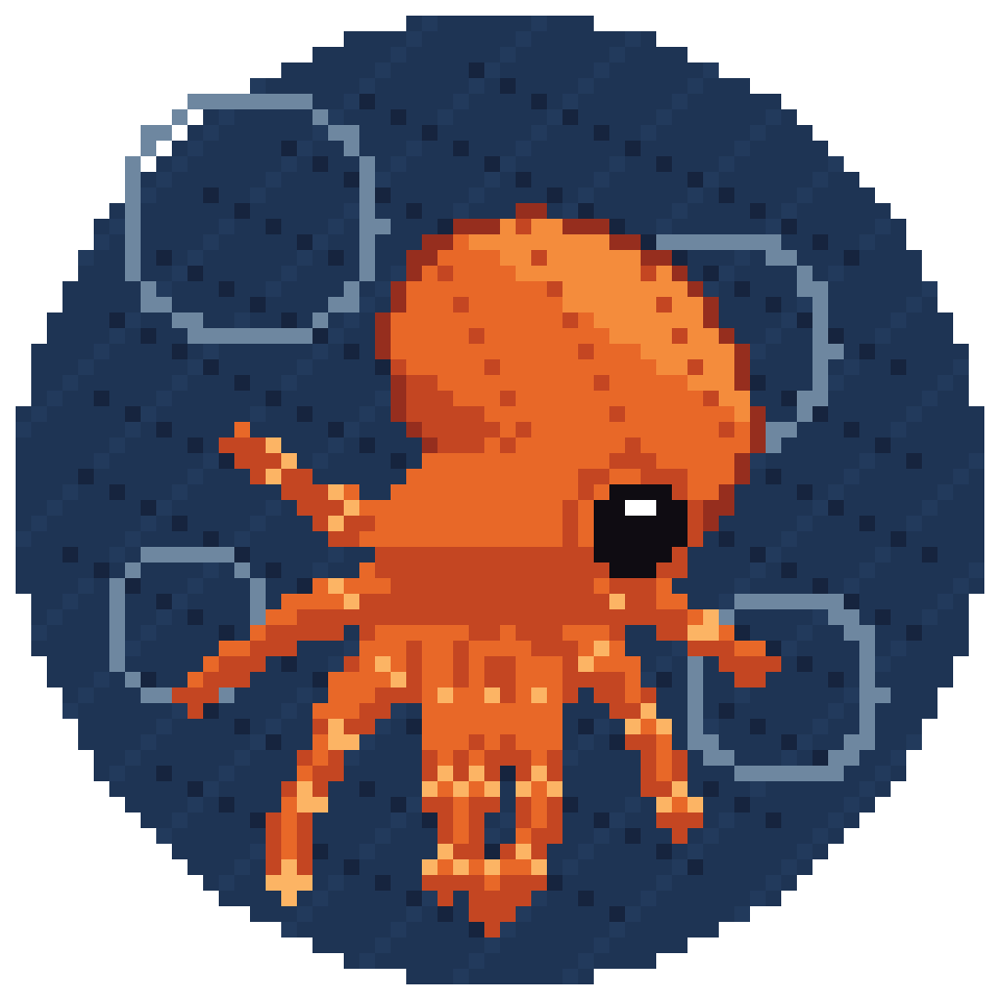
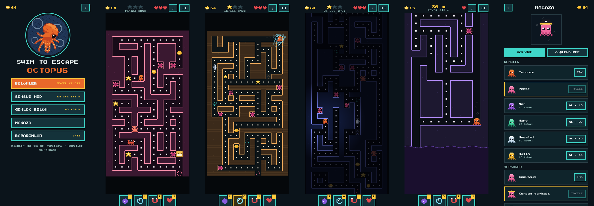
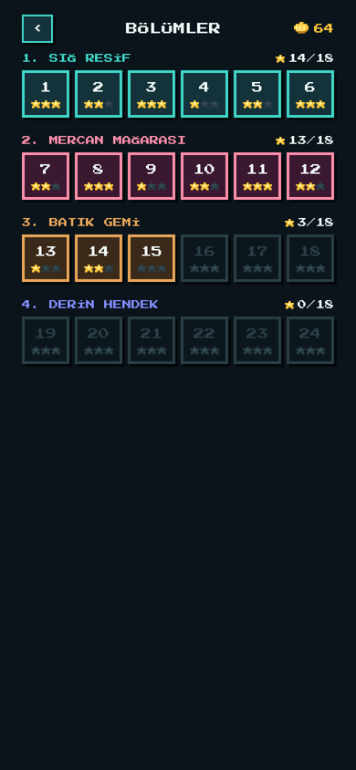
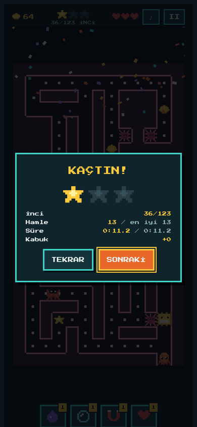
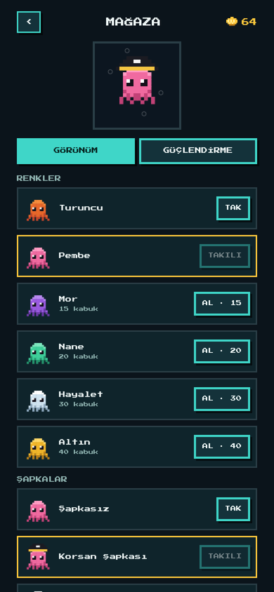

<p align="center"></p>

# Swim to Escape: Octopus 🐙

A pixel-art swipe maze game for Android and iOS, inspired by *Tomb of the Mask*.
Swipe and the octopus swims until it hits a wall. Collect pearls, stars and golden shells, dodge sea creatures, and escape through the portal. In endless mode you climb away from rising ink.

<p align="center"></p>

## Features

**4 worlds · 24 levels**, each world has its own colors, music and mechanics

| World | Levels | New mechanics |
|---|---|---|
| Shallow Reef | 1–6 | sea urchins |
| Coral Cave | 7–12 | breakable coral, crabs, puffer fish |
| Shipwreck | 13–18 | currents, whirlpool portals, sharks |
| Deep Trench | 19–24 | everything mixed, plus limited light |

- **Enemies:** crabs walk back and forth, sharks patrol corridors, and puffer fish shake and then puff up. Timing matters.
- **Ink ability:** free once per level. It stuns every urchin and enemy within 3 cells for 4.5 seconds.
- **Power-ups** bought with shells: shield bubble, pearl magnet and extra life.
- **Endless mode:** an infinite shaft that keeps generating, with ink rising from below. You earn shells as you climb, your ink refills every 100 m, and your best height is saved.
- **Daily level:** a new level generated each day, with +5 shells for the first clear.
- **Shell shop:** 6 colors, 3 hats (pirate, sailor, crown) and 3 trails (bubbles, glowing ink, sparkles).
- **12 achievements** worth +5 shells each, plus a pop-up the first time you meet each mechanic.
- **Juice:** screen shake, sparkles, confetti, and best moves/time records per level.
- Original chiptune soundtrack (5 tracks) and 23 sound effects.

<p align="center">



</p>

## No broken maps

Every level is checked by a validator (`tools/mech.py`). The same rules are ported to the game, so it also checks the daily level and each endless chunk on the phone. A level is only accepted if all of these hold:

- the exit is reachable, and from **every** reachable resting state (including which corals are already broken) the exit can still be reached, so there are no soft-locks;
- currents and portals can never create an endless loop;
- every star, shell, coral, current and portal can actually be reached or used;
- crabs, sharks and puffers never cover a cell where the octopus can stop, so waiting is always safe;
- unreachable water becomes rock, and urchins that no path touches are removed.

`tools/play_test.js` plays the real game in a headless browser. It solves all 24 levels, the daily level and 100+ m of endless mode with a BFS solver, and fails on any console error.

## Architecture

The project is a **hybrid app**. The whole game is one offline HTML file (`assets/game/index.html`) built from `web/`. The Flutter app (`lib/main.dart`) shows that file full-screen in a WebView and adds:

- saving progress to `SharedPreferences` (`SaveChannel`),
- haptics (`HapticChannel`),
- Android back-button handling,
- pausing the game and audio when the app goes to the background.

```
web/index.html, web/js/*.js   game source (rules, worlds, game, render, UI)
tools/build_web.py            inlines JS, levels, audio, font, logo -> assets/game/index.html
tools/mech.py                 level validator + mechanic placer -> tools/levels_v2.json
tools/synth.py                synthesizes all music & sound effects
tools/play_test.js            headless auto-player test
lib/main.dart                 Flutter WebView shell
```

## Run

```bash
flutter create --platforms=android,ios --org com.muba14 --project-name swim_to_escape .
flutter pub get
dart run flutter_launcher_icons
flutter run                     # or: flutter build apk --release
```

**APK without a local setup:** every push runs `.github/workflows/build-apk.yml`. Open *Actions → latest run → swim-to-escape-apk* to download the APK.

**Edit the game:**

```bash
python3 tools/mech.py          # place mechanics & validate levels
python3 tools/synth.py         # rebuild audio
python3 tools/build_web.py     # rebuild assets/game/index.html
npm i playwright && node tools/play_test.js
```

You can also open `assets/game/index.html` directly in a browser to play.
Controls: swipe or arrow keys/WASD, Space for ink, Esc to pause.

## Credits & licenses

- **Music & sound effects:** original, synthesized from scratch by `tools/synth.py` with no samples. Released as **CC0**.
- **Font:** [Press Start 2P](https://fonts.google.com/specimen/Press+Start+2P) by CodeMan38, SIL Open Font License 1.1 (`web/fonts/OFL.txt`).
- **Art:** all pixel art is original and drawn in code.
